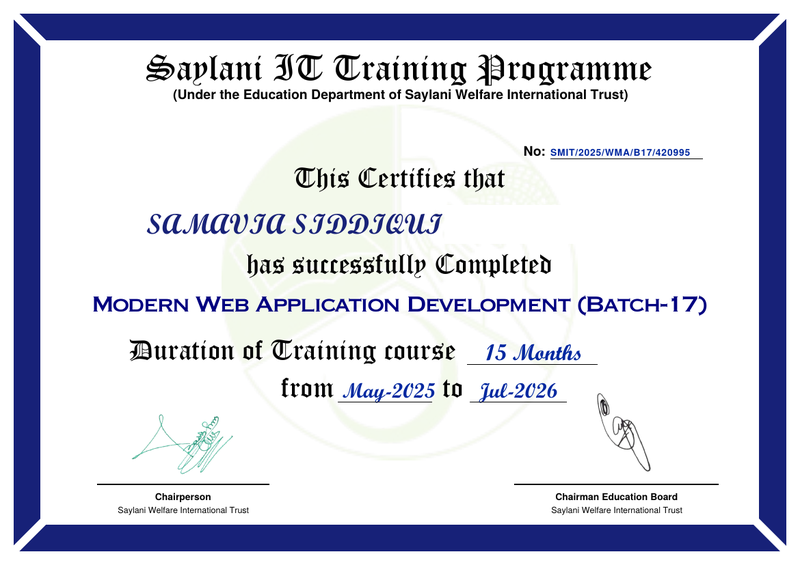
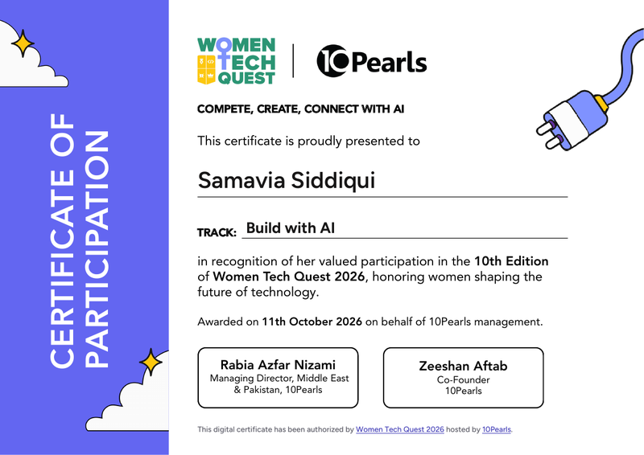
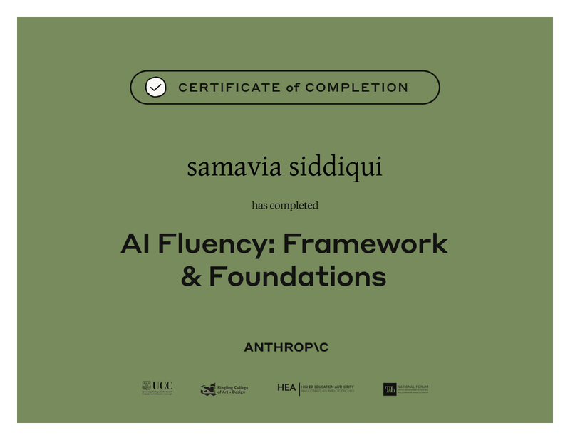
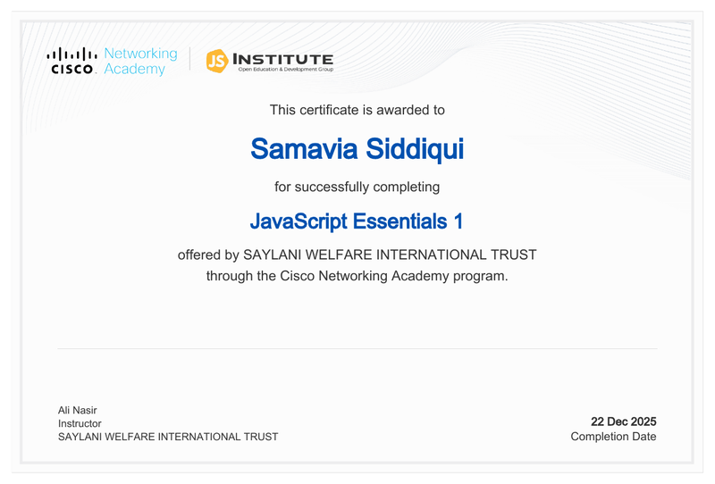
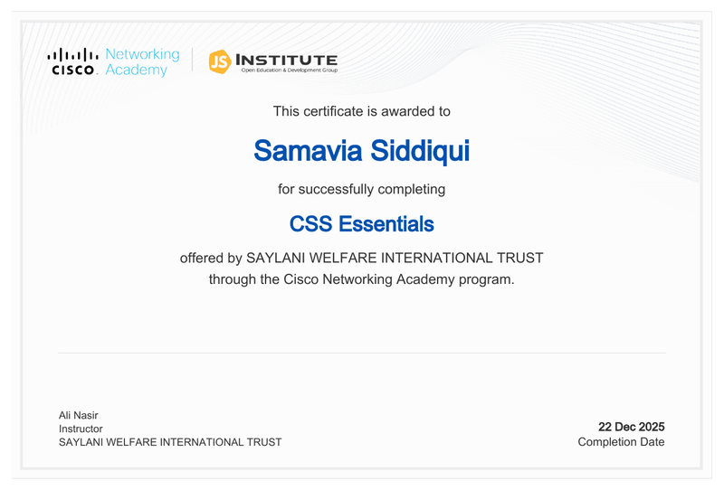

<div align="center">
  
  <p><strong>I build fast, animated web apps for businesses that want to stand out.</strong></p>
  
</div>

[](https://samavia-siddiqui.vercel.app)
[](https://www.linkedin.com/in/samavia-siddiqui-398322381)
[](mailto:samaviasiddiqui3@gmail.com)

---

## 👋 About

Full Stack Developer from Karachi, Pakistan, working with the MERN stack and modern web technologies. I build responsive, performance-focused experiences for businesses, founders, and product teams.

Open to freelance web development and product-focused builds.

```javascript
const samavia = {
  role: "Full Stack Developer",
  stack: ["React", "Node.js", "Express", "MongoDB", "Tailwind CSS", "Framer Motion"],
  training: "Modern Web Application Development, SMIT (completed Jul 2026)",
  location: "Karachi, Pakistan",
  openTo: "Freelance web development"
};
```

---

## ⚡ Tech Stack

<div align="center">
  
</div>

---

## 💼 What I Build

| Service | Details |
|---|---|
| Full Stack Web Apps | React + Node/Express + MongoDB, dashboards, auth flows, APIs |
| Landing Pages & Business Websites | Fast, responsive, conversion-focused websites with smooth motion |
| Website Redesign | Modernizing slow, outdated interfaces for better performance and UX |

Get a quote: [samavia-siddiqui.vercel.app](https://samavia-siddiqui.vercel.app)

---

## 🚀 Featured Projects

| Project | What it is | Tech | Links |
|---|---|---|---|
| Orbit Support Flow | Real-time support ticket dashboard with agent roles, WebSockets and JWT login | React · Node.js · Express · MongoDB | [Live](https://orbit-support-flow-final-hackathon-2025.vercel.app/) · [Code](https://github.com/Samavia-siddiqui/Orbit-support-flow) |
| SplitEasy | Shared expense tracker with groups, invites and balance settlement | React · Node.js · Express · MongoDB | [Live](https://expence-traker-psi.vercel.app/) · [Code](https://github.com/Samavia-siddiqui/expense-tracker) |
| StudyMate | AI study assistant that builds 3-day roadmaps by subject and importance | React · Node.js · Express · MongoDB · AI | [Live](https://studymate-ai-bay-delta.vercel.app/) · [Code](https://github.com/Samavia-siddiqui/StudyMate-AI) |
| GlowNotes | Notes app with full CRUD, dark mode and Framer Motion animations | React · Node.js · Express · MongoDB | [Live](https://notes-app-tawny-rho-40.vercel.app/) · [Code](https://github.com/Samavia-siddiqui/Notes-App) |
| ShowCase | Developer hub to add and browse projects with accounts | React · Node.js · Express · MongoDB | [Code](https://github.com/Samavia-siddiqui/Project-showcaser-App) |

<details>
<summary><b>More projects: front-end and landing pages</b></summary>

| Project | What it is | Tech | Links |
|---|---|---|---|
| Sami's Collections | E-commerce front-end with cart, blog and contact form | React · Tailwind · Framer Motion | [Live](https://ecommerce-store-chi-five.vercel.app/) · [Code](https://github.com/Samavia-siddiqui/Ecommerce-Store) |
| Verde | Sneaker store with quick add and dark/light mode | React · Tailwind · Framer Motion | [Live](https://shoe-web-two.vercel.app/) · [Code](https://github.com/Samavia-siddiqui/Shoe-web) |
| CraveBite | Fast food website with menu, cart buttons and contact form | React · Tailwind · Framer Motion | [Live](https://fast-food-website-vr2g.vercel.app/) · [Code](https://github.com/Samavia-siddiqui/Fast-Food-Website) |
| HerDailyFinds | Lifestyle blog with curated finds and dark mode | React · Tailwind · Framer Motion | [Live](https://her-daily-finds.vercel.app/) · [Code](https://github.com/Samavia-siddiqui/HerDailyFinds) |
| FlavorRush | Dark animated single-page restaurant site | React · TypeScript · Vite · Tailwind | [Live](https://fast-food-website-blond.vercel.app/) · [Code](https://github.com/Samavia-siddiqui/Fast-Food-Website-2) |
| Devflow | SaaS-style landing page with reusable components | React · Tailwind | [Live](https://dev-flow-topaz.vercel.app/) · [Code](https://github.com/Samavia-siddiqui/DevFlow) |
| BloomHaven | Flower shop website with reusable components | React | [Live](https://bloom-haven-gules.vercel.app/) · [Code](https://github.com/Samavia-siddiqui/Bloom-Haven) |
| BLOOMING Creations | Flower bouquet site in pure HTML and CSS | HTML · CSS | [Live](https://samavia-siddiqui.github.io/BLOOMING-creations/) · [Code](https://github.com/Samavia-siddiqui/BLOOMING-creations) |
| WanderLust | Travel blog landing site | HTML · CSS · JavaScript | [Live](https://wander-lust-project-eight.vercel.app/) · [Code](https://github.com/Samavia-siddiqui/WanderLust-Project) |
| Prime Estates | Real estate landing page | HTML · CSS | [Live](https://real-state-landing-page-ebon.vercel.app/) · [Code](https://github.com/Samavia-siddiqui/Real-State-Landing-page) |

</details>

---

## 🏅 Certifications

<div align="center">

<table>
  <tr>
    <td align="center" width="33%">
      <a href="smit-modern-web-application-development.png"></a><br/>
      <sub><b>Modern Web Application Development</b><br/>Saylani Mass IT Training · May 2025 to Jul 2026</sub>
    </td>
    <td align="center" width="33%">
      <a href="women-tech-quest-2026-participation.pdf"></a><br/>
      <sub><b>Women Tech Quest 2026: Build with AI</b><br/>10Pearls · Oct 2026 (Participation)</sub>
    </td>
    <td align="center" width="33%">
      <a href="anthropic-ai-fluency.pdf"></a><br/>
      <sub><b>AI Fluency: Framework &amp; Foundations</b><br/>Anthropic · 2026</sub>
    </td>
  </tr>
  <tr>
    <td align="center" width="33%">
      <a href="cisco-javascript-essentials-1.pdf"></a><br/>
      <sub><b>JavaScript Essentials 1</b><br/>Cisco Networking Academy · Dec 2025</sub>
    </td>
    <td align="center" width="33%">
      <a href="cisco-html-essentials.pdf"></a><br/>
      <sub><b>HTML Essentials</b><br/>Cisco Networking Academy · Dec 2025</sub>
    </td>
    <td align="center" width="33%">
      <a href="cisco-css-essentials.pdf"></a><br/>
      <sub><b>CSS Essentials</b><br/>Cisco Networking Academy · Dec 2025</sub>
    </td>
  </tr>
</table>

</div>

Also: Cisco Introduction to Cybersecurity and HP LIFE AI for Business Professionals. See [LinkedIn](https://www.linkedin.com/in/samavia-siddiqui-398322381).

---

## 🤝 Let’s Work Together

Have a project in mind? Send me your idea, budget, and deadline.

**Portfolio:** [samavia-siddiqui.vercel.app](https://samavia-siddiqui.vercel.app)  
**LinkedIn:** [Samavia Siddiqui](https://www.linkedin.com/in/samavia-siddiqui-398322381)  
**Email:** [samaviasiddiqui3@gmail.com](mailto:samaviasiddiqui3@gmail.com)

<div align="center">
  
</div>
